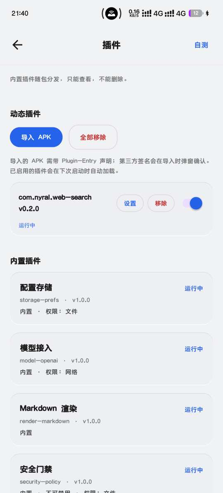

# Nyral Lite

<p align="center">
  
  
  
  
  
</p>

一个轻量的 Android LLM 聊天客户端：流式对话、Markdown 与表格渲染、工具调用、人设卡和插件扩展。
单模块 Kotlin 工程，不依赖私有服务，填入任意兼容 Chat Completions 的服务地址即可使用。

## 功能

### 聊天与渲染
- 流式输出，思考过程可折叠查看（摘要行 + 全文抽屉）
- Markdown 单引擎渲染：标题、列表、代码块与表格，流式与收尾走同一解析路径
- 消息入场动效、空会话欢迎页、输入草稿自动保存
- 图片附件发送与全屏查看，语音输入（系统语音识别）

### 工具调用
- 内置系统工具：拨号、打开网页、发送通知、分享文本、前台任务等
- 会话历史搜索、长期记忆检索作为工具暴露给模型
- 工具执行卡片展示结果与耗时，失败可一键重试
- 远程 MCP 服务器（Streamable HTTP，兼容 SSE 响应），支持连接测试

### 人设
- 导入 `chara_card_v2` 角色卡（JSON，或图片内嵌数据的 PNG）
- 短人设（指令、性格、场景）与长人设（描述、示例、互动要求）双档
- 开场白、自定义头像；已有消息的会话切换人设时默认新建会话

### 记忆与历史
- 会话结束后自动提取长期记忆，带去重与评分
- 会话历史、全文搜索与自动摘要

### 插件
- 内置插件随包分发：配置存储、模型接入、Markdown 渲染、安全门禁、语音识别、附件存储
- 动态插件：导入外部 Dex APK，向模型注册自定义工具，第三方签名导入时弹窗确认

### 安全门禁
- 三档位：放行 / 自动（高危工具需确认）/ 严格（仅白名单放行）
- 工具白名单与禁止名单（禁止名单优先）
- 工具审计日志，可导出排查

### 安全口径（门禁不是沙箱）

- 门禁管的是「模型能否调用某个工具」，管不了插件代码本身：动态插件一经装载，就以本应用的全部权限运行。只装可信来源的插件。
- 插件信任绑定整个 APK 文件的 SHA-256（按插件 id 记录）：更新或回装旧版本都会因哈希变化重新弹窗确认，卸载即清除记录。证书指纹只用于弹窗展示，不作为信任依据。
- API Key 用 AES-256-GCM 加密存储，密钥生成在 AndroidKeyStore 内、不可导出；换机迁移后需重新填写。
- 更新检查只连 GitHub Releases，失败静默跳过；升级始终由用户手动确认，不做静默下载安装。

### 其他
- 启动时静默检查 GitHub Release 更新
- 前台服务保障长任务执行

## 环境要求

- Android 12 及以上（minSdk 31）
- JDK 17
- Android SDK 36

## 构建与安装

```bash
./gradlew :app:assembleDebug --console=plain
adb install -r app/build/outputs/apk/debug/app-debug.apk
```

首次启动后在「设置 → 模型接入」填写兼容 Chat Completions 的服务地址、密钥与模型名；
需要远程工具时在「设置 → MCP 服务器」填写 MCP 地址。

## 目录

| 路径 | 说明 |
|---|---|
| `app/` | 主应用（界面、会话、聊天流、内置插件） |
| `testplugin/` | 外部 Dex 插件的最小示例工程 |
| `docs/plugin-dev.md` | 插件开发指南 |
| `AGENTS.md` | 本项目的开发约定 |

## 插件开发

插件是一个装进 App 的动态 Dex APK，可以向模型注册工具、调用宿主能力。
完整的契约说明、最小工程、示例工具与排错表见 [docs/plugin-dev.md](docs/plugin-dev.md)。

## 版本记录

### v0.1.1 · 2026-11-28 · versionCode 3

- 安全：工具门禁前移到统一分发口；API Key 改 Keystore 加密存储并自动迁移；http 端点保存前明文风险警告；插件信任绑定 APK 文件哈希；插件 ID 白名单校验
- 修复：门禁确认移到 IO 线程杜绝 ANR；审批宿主 onResume/onPause 对称登记；前台服务任务登记竞态
- 打磨：门禁弹窗说明化——工具中文名、一句用途说明、参数可读化；只读工具预置白名单
- 界面：全套视觉打磨——卡片质感、入场动效、底排图标化、门禁胶囊等
- 健壮性：Skill 注入长度预算，角色卡解压加上限
### v0.1.0 · 2026-11-27 · versionCode 1

首个公开版本。

- 流式聊天与可折叠思考过程
- Markdown、代码块与表格渲染
- 工具调用：内置系统工具 + 远程 MCP
- 人设卡导入（chara_card_v2 JSON / PNG）
- 会话历史、摘要与长期记忆
- 动态 Dex 插件扩展
- 三档安全门禁与工具审计日志
- 启动时静默检查 GitHub Release 更新
- 动态插件：release 包保留 Kotlin 标准库，debug 构建的插件可直接导入

## 许可证

MIT，见 [LICENSE](LICENSE)。安全策略见 [SECURITY.md](SECURITY.md)，隐私说明见 [PRIVACY.md](PRIVACY.md)。
